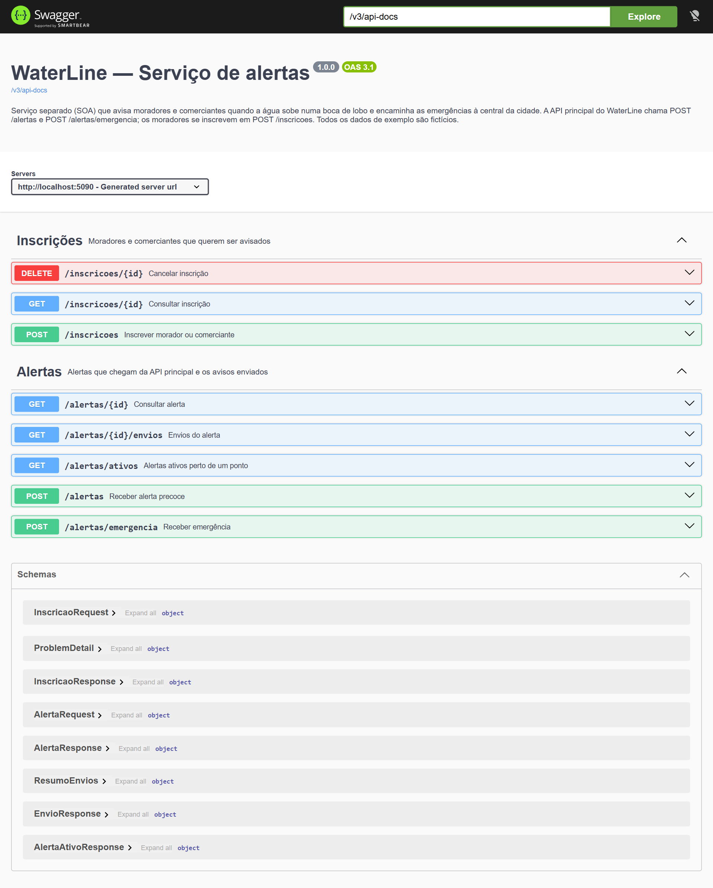
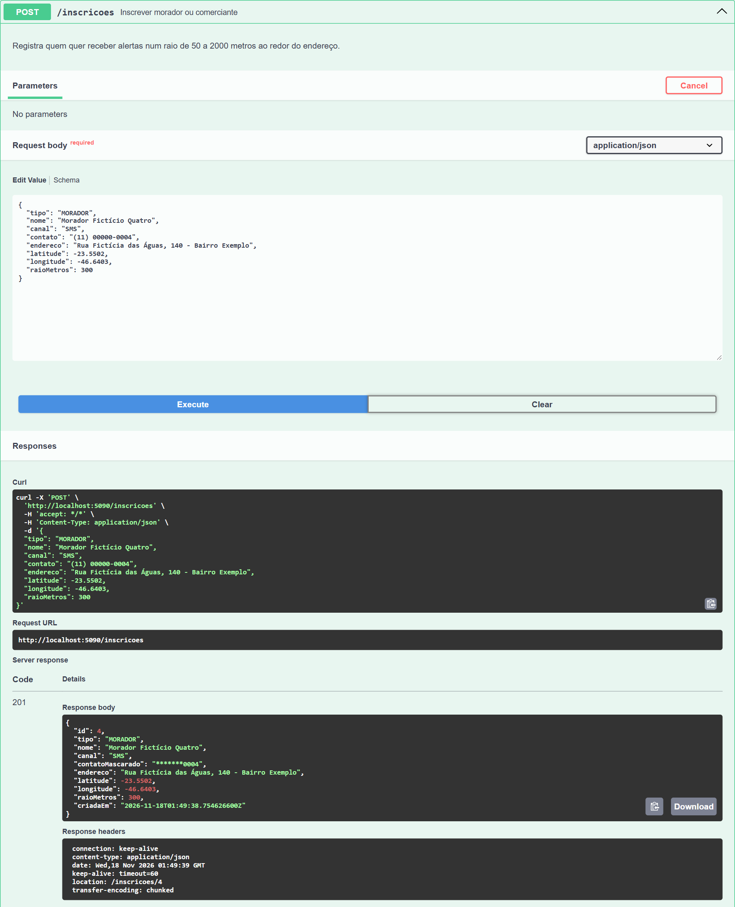
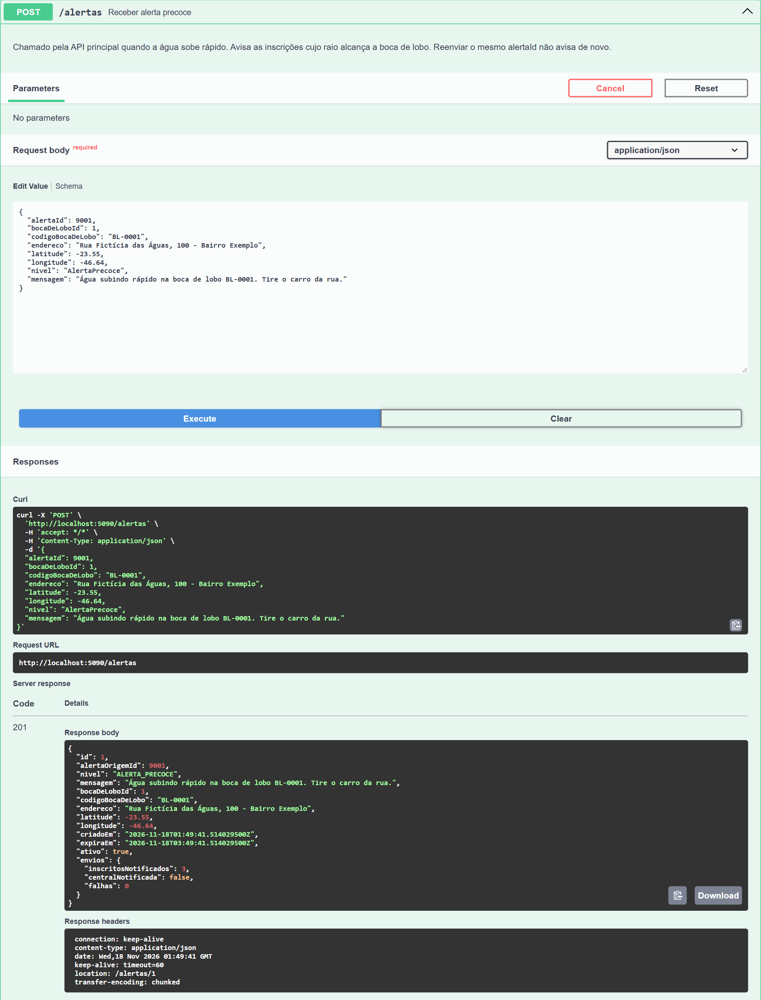
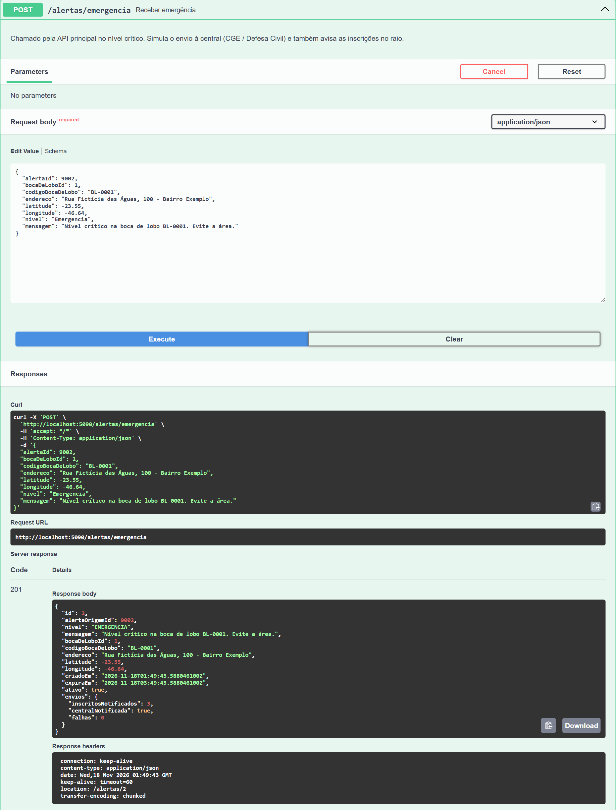
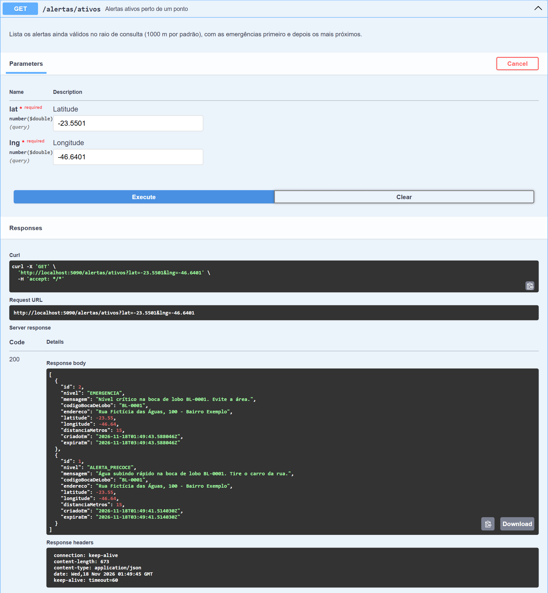
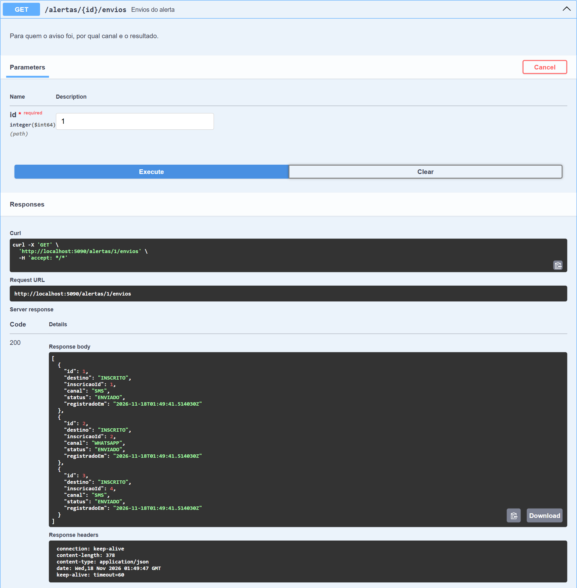
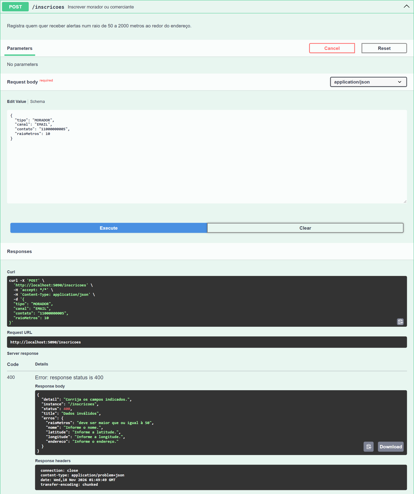

# WaterLine — Serviço de alertas (SOA)

Serviço separado do WaterLine que **avisa moradores e comerciantes quando a água sobe numa boca de lobo** e **encaminha as emergências à central da cidade**. A API principal (C#) detecta a água subindo e chama este serviço por REST; cada serviço tem o seu domínio e o seu banco.

Disciplina: **Arquitetura Orientada a Serviços (SOA) e Web Services** — Global Solution 2026.2.

## Integrantes

| Nome | RM |
| --- | --- |
| Carlos Eduardo de Queiroz Menezes | RM99849 |
| Leonardo Correia | RM550413 |

## Repositórios do projeto

| Parte | Repositório |
| --- | --- |
| Serviço de alertas (SOA), este repositório | https://github.com/Carlosqmenezes/GS_WATER-LINE_SOA |
| API principal (C#), que chama este serviço | https://github.com/Carlosqmenezes/GS_WATER-LINE_C-Sharp |
| App do gari (Mobile) | https://github.com/Carlosqmenezes/GS_WATER-LINE_mobile |
| Previsão de chuva (IA & ML) | https://github.com/Carlosqmenezes/GS_WATER-LINE_IA-ML |

## Ficha da CitizenTech

| Campo | Conteúdo |
| --- | --- |
| Nome da CitizenTech | WaterLine |
| Cidade e bairro | São Paulo, Centro (Sé/República) – Vale do Anhangabaú e Terminal Bandeira. Na chuva de 14/10/2026, o Túnel do Anhangabaú e o Terminal Bandeira alagaram, com carros boiando ([Agência Brasil](https://agenciabrasil.ebc.com.br/meio-ambiente/noticia/2026-10/chuva-alaga-ruas-do-centro-e-deixa-um-morto-na-zona-norte-de-sao-paulo), [TMC](https://tmc.com.br/brasil/chuva-sp-alaga-terminal-bandeira-metro-trianon-alertas/)). |
| Cidadão beneficiado | Morador e pequeno comerciante de rua com alagamento recorrente; gari e equipe de galeria como agentes públicos |
| Problema, em uma frase | Bocas de lobo entupidas transformam chuva comum em alagamento, e a limpeza e o aviso chegam tarde porque ninguém sabe a tempo onde agir. |
| Como funciona | Sensores na boca de lobo detectam entupimento externo e interno e a água subindo; o ML prevê chuva forte; a API despacha o agente certo mais próximo e alerta moradores e a central. |
| Papel deste serviço | Guardar quem quer ser avisado, encontrar as inscrições no raio da boca de lobo em alerta, registrar cada envio e simular o aviso à central (CGE / Defesa Civil). |
| Link do repositório | https://github.com/Carlosqmenezes/GS_WATER-LINE_SOA |
| Indicador de impacto | Minutos de antecedência entre o alerta e o nível crítico; número de moradores e comerciantes avisados por alerta. |
| ODS conectados | 11 (cidades sustentáveis), 13 (ação climática), 9 (infraestrutura), 3 (saúde), 8 (trabalho decente) |

---

## Arquitetura

```
 ESP32 ──► API principal (C#, :5080) ──── REST ────► Serviço de alertas (Java, :5090) ──► moradores e comerciantes
           banco waterline (:5432)    POST /alertas               banco waterline_alertas (:5433)   (SMS, WhatsApp, e-mail)
                                      POST /alertas/emergencia                                  ──► central (CGE / Defesa Civil)
```

**Por que um serviço separado.** O alerta tem regras e dados próprios: quem se inscreveu, em qual raio, por qual canal, e o histórico de cada envio. Nada disso interessa à API principal, que só precisa dizer "a água está subindo nesta boca de lobo". Separando:

- **Banco próprio.** Os telefones e e-mails dos moradores ficam só aqui, longe dos dados dos agentes e dos sensores.
- **Contrato estável.** A API principal envia só dados da boca de lobo (infraestrutura pública). O formato está na seção [Integração com a API principal](#integração-com-a-api-principal).
- **Falha isolada.** Se este serviço cair, a API principal continua gravando o alerta no banco dela e segue funcionando; o envio volta a acontecer nos próximos alertas.
- **Tecnologia independente.** A API principal é .NET; este serviço é Java com Spring Boot.

## Tecnologias

| Tecnologia | Versão | Para que serve |
| --- | --- | --- |
| Java (Temurin) | 21 | Linguagem |
| Spring Boot (Web MVC, Validation) | 4.1.2 | API REST e validação das entradas |
| Spring Data JPA + Hibernate | do Spring Boot 4.1.2 | Mapeamento das entidades e consultas |
| PostgreSQL | 16 (Docker) | Banco próprio do serviço |
| Flyway | do Spring Boot 4.1.2 | Migrações versionadas do banco |
| springdoc-openapi (Swagger UI) | 3.2.0 | Documentação automática |
| JUnit 5, AssertJ, MockMvc, H2 | do Spring Boot 4.1.2 | Testes automatizados |
| Maven Wrapper | incluso (`mvnw`) | Build sem precisar instalar o Maven |

## Estrutura

```
src/main/java/br/com/waterline/alertas/
  AlertasServiceApplication.java
  dominio/                  Regras de negócio, sem dependência da web
    Inscricao.java          Morador ou comerciante: rua, raio, canal; regra de raio
    Alerta.java             Nível, mensagem, origem; validade; registro dos envios
    Envio.java              Para quem, quando, por qual canal e o resultado
    Coordenada.java         Latitude e longitude; distância por Haversine
    OrigemAlerta.java       Boca de lobo que gerou o alerta
    NivelAlerta, TipoInscrito, Canal, DestinoEnvio, StatusEnvio
    excecao/                Regra de negócio (422), não encontrado (404), conflito (409)
  repositorio/              Spring Data JPA
  servico/                  Casos de uso: InscricaoService, AlertaService, Notificador
  api/                      Controllers REST, DTOs e tratamento de erros (ProblemDetail)
  configuracao/             Propriedades, relógio e informações do OpenAPI
src/main/resources/
  application.properties    Configuração (porta, banco, raio de consulta, validade)
  application-dev.properties Senha local e dados de demonstração
  db/migration/             V1 inscrições, V2 alertas, V3 envios
  db/dev/                   Inscrições fictícias de demonstração (só no perfil dev)
src/test/java/              Testes de domínio e de endpoints
docs/prints/                Evidências
docker-compose.yml          PostgreSQL do serviço
```

## Domínio

| Entidade | Campos principais | Regras |
| --- | --- | --- |
| `Inscricao` | tipo (`MORADOR` ou `COMERCIANTE`), nome, contato, canal (`SMS`, `WHATSAPP`, `EMAIL`), endereço, latitude, longitude, raio | Raio de 50 a 2000 m. Telefone com DDD (10 a 13 dígitos) para SMS e WhatsApp; e-mail válido para EMAIL. Um contato por canal. O contato só sai mascarado (`*******0004`). |
| `Alerta` | id na API principal, nível (`ALERTA_PRECOCE` ou `EMERGENCIA`), mensagem, origem (boca de lobo, código, endereço), localização, criado em, expira em | Válido por 2 horas (`alertas.validade`). O mesmo id da API principal não é registrado duas vezes. Só emergência vai para a central. |
| `Envio` | alerta, inscrição, destino (`INSCRITO` ou `CENTRAL`), canal, status (`ENVIADO` ou `FALHOU`), registrado em | Um envio por inscrição alcançada; mais um para a central na emergência. |

```
Inscricao 1 ──── 0..* Envio 0..* ──── 1 Alerta
                 (inscrição nula no envio à central ou depois de cancelada)
```

### Regra de raio

Quando chega um alerta numa boca de lobo, o serviço:

1. Busca no banco só as inscrições dentro de um retângulo de 2000 m ao redor da boca de lobo (consulta indexada por latitude e longitude).
2. Calcula a distância real de cada uma pela fórmula de Haversine (`Coordenada.distanciaEmMetros`).
3. Avisa as inscrições cujo **raio escolhido pelo morador** alcança a boca de lobo (`Inscricao.cobre`) e registra um `Envio` para cada uma.
4. Na emergência, registra também o envio à central.

O envio é **simulado** (`NotificadorSimulado`): o serviço registra o envio como `ENVIADO` e escreve no log só os ids. Trocar por um provedor real de SMS ou e-mail é implementar a interface `Notificador`.

`GET /alertas/ativos?lat=&lng=` usa a mesma conta para o caminho inverso: um morador consulta os alertas válidos a até 1000 m (`alertas.raio-consulta-metros`), com as emergências primeiro e depois os mais próximos.

## Banco de dados e migrações

O serviço usa o **seu próprio PostgreSQL**, num contêiner separado do banco da API principal (porta 5433, banco `waterline_alertas`).

| Migração | O que cria |
| --- | --- |
| `V1__criar_inscricoes.sql` | Tabela `inscricoes`, com checagens de tipo, canal, raio e coordenadas, contato único por canal e índice de localização |
| `V2__criar_alertas.sql` | Tabela `alertas`, com id de origem único, checagem de nível e validade, e índices de validade e localização |
| `V3__criar_envios.sql` | Tabela `envios`, com chaves estrangeiras para alertas (`ON DELETE CASCADE`) e inscrições (`ON DELETE SET NULL`) |
| `R__inscricoes_de_demonstracao.sql` | Três inscrições fictícias, só no perfil `dev` |

O Flyway aplica as migrações ao subir o serviço, e o Hibernate roda com `ddl-auto=validate`: se uma entidade não bater com o banco, o serviço não sobe. Os testes rodam as mesmas migrações num H2 em memória.

## Como executar

**Pré-requisitos:** JDK 21 e Docker. O Maven não precisa ser instalado: o projeto usa o Maven Wrapper.

```bash
# 1. Banco do serviço
docker compose up -d

# 2. Serviço (perfil dev: senha local e inscrições de demonstração)
./mvnw spring-boot:run          # Windows: mvnw.cmd spring-boot:run
```

- Swagger UI: http://localhost:5090/swagger-ui.html
- OpenAPI (JSON): http://localhost:5090/v3/api-docs

Para gerar o `.jar`: `./mvnw package` e depois `java -jar target/alertas-service-1.0.0.jar`.

### Configuração

| Propriedade | Variável de ambiente | Padrão |
| --- | --- | --- |
| `server.port` | `PORTA` | `5090` |
| `spring.datasource.url` | `ALERTAS_DB_URL` | `jdbc:postgresql://localhost:5433/waterline_alertas` |
| `spring.datasource.username` | `ALERTAS_DB_USUARIO` | `waterline_alertas` |
| `spring.datasource.password` | `ALERTAS_DB_SENHA` | `alertas_dev` no perfil `dev`; vazia fora dele |
| `alertas.raio-consulta-metros` | `ALERTAS_RAIO_CONSULTA_METROS` | `1000` |
| `alertas.validade` | `ALERTAS_VALIDADE` | `2h` |

O perfil `dev` é o padrão. Fora do ambiente local, use `SPRING_PROFILES_ACTIVE=prod` (ou qualquer outro nome), defina `ALERTAS_DB_SENHA` e as inscrições de demonstração não são carregadas.

## Integração com a API principal

A API C# já tem o cliente deste serviço (`HttpAlertaClient`). Para ligá-la, suba este serviço e rode a API com a variável `Alertas__BaseUrl`:

```bash
# na pasta da API C#
Alertas__BaseUrl=http://localhost:5090 dotnet run --project src/WaterLine.Api
```

Sem a variável, a API só grava o alerta no banco dela e registra em log.

**Contrato** (o que a API principal envia em `POST /alertas` e `POST /alertas/emergencia`):

```json
{
  "alertaId": 3,
  "bocaDeLoboId": 1,
  "codigoBocaDeLobo": "BL-0001",
  "endereco": "Rua Fictícia das Águas, 100 - Bairro Exemplo",
  "latitude": -23.55,
  "longitude": -46.64,
  "nivel": "AlertaPrecoce",
  "mensagem": "Água subindo rápido na boca de lobo BL-0001 ...",
  "criadoEm": "2026-11-18T01:51:02.1Z"
}
```

`nivel` aceita tanto o formato do C# (`AlertaPrecoce`, `Emergencia`) quanto o deste serviço (`ALERTA_PRECOCE`, `EMERGENCIA`). Se a API reenviar o mesmo `alertaId`, a resposta é **200** com o alerta já registrado, e ninguém é avisado de novo.

**Teste de ponta a ponta realizado.** Com os dois serviços no ar, três leituras na BL-0001 pela API principal (`POST /leituras`: chuva com nível normal, água subindo, nível crítico) geraram:

```
API C#           Alerta 3 (AlertaPrecoce) enviado ao serviço de alertas.
API C#           Alerta 4 (Emergencia) enviado ao serviço de alertas.
Serviço alertas  Alerta 3 (ALERTA_PRECOCE) registrado com 3 envio(s).
Serviço alertas  Envio simulado: alerta 4 para a inscrição 1 por SMS.
Serviço alertas  Envio simulado: alerta 4 para a inscrição 2 por WHATSAPP.
Serviço alertas  Envio simulado: alerta 4 para a inscrição 4 por SMS.
Serviço alertas  Envio simulado: emergência do alerta 4 para a central (CGE / Defesa Civil).
Serviço alertas  Alerta 4 (EMERGENCIA) registrado com 4 envio(s).
```

A inscrição 3 (Vila Teste, a cerca de 1,3 km) não foi avisada: o raio dela (300 m) não alcança a BL-0001.

## Endpoints

| Método | Rota | Quem chama | Sucesso | Erros |
| --- | --- | --- | --- | --- |
| POST | `/inscricoes` | Morador ou comerciante | 201 com `Location` | 400, 409 (contato já inscrito), 422 (contato incompatível com o canal) |
| GET | `/inscricoes/{id}` | Morador ou comerciante | 200 (contato mascarado) | 404 |
| DELETE | `/inscricoes/{id}` | Morador ou comerciante | 204 (apaga os dados pessoais) | 404 |
| POST | `/alertas` | API principal | 201 (novo) ou 200 (já recebido) | 400, 422 (emergência na rota errada) |
| POST | `/alertas/emergencia` | API principal | 201 (novo) ou 200 (já recebido) | 400, 422 (alerta precoce na rota errada) |
| GET | `/alertas/ativos?lat=&lng=` | Morador, painel | 200, emergências primeiro e depois por distância | 400 |
| GET | `/alertas/{id}` | Painel | 200 com o resumo dos envios | 404 |
| GET | `/alertas/{id}/envios` | Painel | 200 | 404 |

Os erros seguem o padrão **ProblemDetail** (RFC 9457, `application/problem+json`), com mensagens em português e, nos erros de validação, o campo `erros` indicando cada campo.

### Roteiro pelo Swagger

Com o banco recém-criado (as inscrições 1, 2 e 3 vêm do seed de demonstração):

1. `POST /inscricoes` com um morador a ~25 m da BL-0001 e raio de 300 m → **201**.
2. `POST /alertas` com um alerta precoce na BL-0001 (`latitude -23.55`, `longitude -46.64`) → **201**, `envios.inscritosNotificados = 3`.
3. `POST /alertas/emergencia` na mesma boca de lobo → **201**, `envios.centralNotificada = true`.
4. `GET /alertas/ativos?lat=-23.5501&lng=-46.6401` → os dois alertas, a emergência primeiro.
5. `GET /alertas/1/envios` → um envio por inscrição alcançada; a inscrição 3 não aparece.
6. Repita o passo 2 → **200**, e nada é reenviado.

## Testes automatizados

```bash
./mvnw test
```

**28 testes, todos passando.** Os de endpoint sobem o Spring inteiro com MockMvc sobre um H2 em memória, com as mesmas migrações do Flyway.

| Classe | O que testa |
| --- | --- |
| `CoordenadaTest` (5) | Haversine (distância zero, ~111 m por milésimo de grau, simetria), retângulo de busca, coordenadas inválidas |
| `InscricaoTest` (7) | **Regra de raio** (dentro, fora e no limite), limites do raio, normalização e máscara do contato, contato incompatível com o canal |
| `AlertaTest` (3) | Validade do alerta, só emergência vai à central, níveis no formato da API C# |
| `AlertasEndpointsTest` (13) | **Alerta avisa só as inscrições no raio**, reenvio não avisa de novo, emergência vai à central, 400/404/409/422, alertas ativos ordenados, cancelamento de inscrição, documentação OpenAPI com todas as rotas |

## Evidências

| Swagger: visão geral |
| --- |
|  |

| POST /inscricoes (201) | POST /alertas (201) |
| --- | --- |
|  |  |

| POST /alertas/emergencia (201) | GET /alertas/ativos (200) |
| --- | --- |
|  |  |

| GET /alertas/{id}/envios (200) | Validação (400) |
| --- | --- |
|  |  |

## Privacidade

- O serviço guarda o mínimo: nome, um contato, a rua e o ponto do endereço. Todos os dados do projeto são fictícios.
- O contato nunca volta inteiro numa resposta: telefone `*******0004`, e-mail `m***@exemplo.com`.
- Os logs registram só ids, nunca nome, contato ou endereço.
- `DELETE /inscricoes/{id}` apaga a inscrição de verdade; o histórico de envios fica, mas sem o vínculo com a pessoa.
- A API principal não envia nenhum dado de agente ou de morador, só da boca de lobo.

## Limitações

- O envio de SMS, WhatsApp, e-mail e o aviso à central são simulados; o serviço registra o envio, mas não fala com um provedor real.
- As rotas não têm autenticação. Em produção, `POST /alertas` precisaria de uma chave entre serviços, e as inscrições, de confirmação do contato (código por SMS ou e-mail).
- Se o banco da API principal for zerado, os ids dos alertas recomeçam em 1 e coincidiriam com os já registrados aqui. Nesse caso, zere também este banco (`docker compose down -v`).
- O serviço roda em HTTP no ambiente local; em produção precisa de HTTPS.
